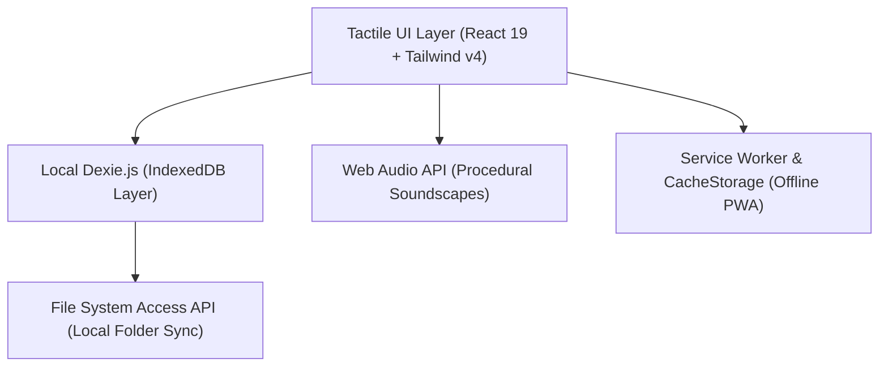
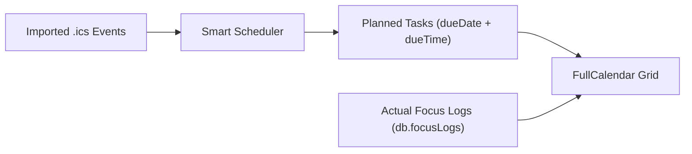

# FocusSpace — Complete Feature Catalog & Architectural Guide

FocusSpace is a **local-first productivity and personal execution operating system** engineered with React 19, TypeScript, Tailwind CSS v4, Dexie.js (IndexedDB), FullCalendar, and TipTap.

Designed around deep tactile ergonomics and zero-knowledge data sovereignty, FocusSpace pairs high-velocity task capture with calendar scheduling, rich-text journaling, habit tracking, and procedural audio focus immersion.

---

## 1. Core Architectural Pillars & Data Sovereignty

### 1.1 Local-First & Zero-Knowledge Storage
* **100% Client-Side IndexedDB**: Every task, habit, goal, journal entry, focus log, and configuration is stored in local browser storage via [`Dexie`](file:///D:/focusspace-phase75/FocusSpace/src/db/db.ts#L4-L24).
* **Zero Mandatory Cloud Accounts**: No third-party servers, tracking pixels, or remote databases. FocusSpace functions with sub-millisecond query latency and zero network dependencies.
* **Storage Resilience**: Automatically calls `navigator.storage.persist()` on boot to prevent browser eviction during low-disk states.
* **Dual Blob Separation**: Page attachments store metadata in `db.files` while binary bytes are isolated in `db.fileBlobs`. Lists and queries never choke on multi-megabyte payloads.

### 1.2 Zero-Server Cross-Device Sync ([`folderSync.ts`](file:///D:/focusspace-phase75/FocusSpace/src/lib/folderSync.ts))
* **File System Access API Integration**: Link a local folder (inside iCloud Drive, Google Drive, Dropbox, or Syncthing) in **Settings &rarr; Data Ownership**.
* **Debounced Local Snapshots**: FocusSpace writes a timestamped `focusspace-sync.json` snapshot to your linked folder whenever data changes, providing automated cross-machine sync without third-party servers.

---

## 2. Tactile Design System & Ergonomic Physics

FocusSpace features a mechanical, physical design system calibrated across four themes and two distinct layout architectures.

### 2.1 The 4 High-Contrast Themes ([`index.css`](file:///D:/focusspace-phase75/FocusSpace/src/index.css#L5-L230))
1. **Solaris (Light)**: Warm Analog Studio inspired by Japanese paper stationery. Vermilion accent (`#e04f26`), botanical sage tones, and soft ivory surfaces.
2. **Swiss Brutal (Light)**: Architectural Grid aesthetic. Neo-brutalist solid black borders, hard ink drop-shadows, and vivid acid citron (`#c8ff29`).
3. **Nocturne Solaris (Dark)**: Pitch-black anodized studio with subtle dot-matrix background texture and glowing vermilion accents (`#ff5526`).
4. **Swiss Onyx (Dark)**: Pitch-black architectural grid (`#0a0c0a`) with vivid neon lime (`#a3e635`). Buttons feature pitch-black typography (`#000000`) for high contrast, while inactive side menus retain crisp ivory-sage legibility.

### 2.2 Mechanical 3D Keycaps (`.keycap`)
* **Physical Extrusion**: Every primary button, badge, and card uses physical CSS depth (`box-shadow: 2px 2.5px 0px var(--c-line)`).
* **Spring-Loaded Tactile Press**: Clicking a button triggers physical travel (`transform: translate3d(2px, 2.5px, 0)`), with `backface-visibility` isolation to prevent layout repaints.
* **Dedicated Accent Physics**: Primary action buttons feature custom multi-layer colored extrusion shadows matching each theme's accent palette.

### 2.3 Dual Layout Navigation Modes ([`App.tsx`](file:///D:/focusspace-phase75/FocusSpace/src/App.tsx#L194-L260))
* **Orbital (Floating Mode)**: Rounded viewport containers (`rounded-[28px]`), bento-grid margins, and tactile floating cards.
* **Cockpit (Split View Mode)**: Full-bleed, edge-to-edge workstation layout featuring a persistently docked Pomodoro Timer on secondary views (Calendar, Analytics, Pages) for multi-tasking execution.

---

## 3. High-Velocity Task Capture & Queue Intelligence

### 3.1 Zero-Dependency Natural Language Parser ([`taskParser.ts`](file:///D:/focusspace-phase75/FocusSpace/src/lib/taskParser.ts))
Type or speak naturally; FocusSpace's inline tokenizer extracts structured metadata in real time:

| Token Trigger | Spoken / Typed Example | Parsed Output Field |
| :--- | :--- | :--- |
| **Category** | `@academics`, `@projects`, `@career` | `categoryId` |
| **Project Tag** | `#Q3`, `#CS101`, `#Launch` | `projectTag` |
| **Priority** | `!urgent`, `!high`, `!med`, `!low` | `priority` (`Urgent` / `High` / etc.) |
| **Estimated Duration** | `~45m`, `~1.5h`, `~30` | `estimatedDuration` (in minutes) |
| **Natural Dates** | `today`, `tomorrow`, `mon`, `in 3 days` | `dueDate` (`YYYY-MM-DD`) |
| **Natural Times** | `at 17:00`, `5pm`, `9:30am`, `noon` | `dueTime` (`HH:mm`) |

### 3.2 Today View & "Do This Next" Recommendation ([`Today.tsx`](file:///D:/focusspace-phase75/FocusSpace/src/components/Today.tsx))
* **"Do This Next" Intelligence**: Evaluates overdue deadlines, priorities, estimated durations, and current time of day to surface the single most critical task to work on right now.
* **Interactive Summary Rings**: Real-time completion percentage dial, total planned minutes, and daily habit completion counts.
* **Queue Segment Controls**: Rapidly toggle between **All**, **Due Today**, **Overdue**, and **Done** task subsets.
* **Custom Drag-and-Drop Sorting**: Manual reordering that persists exact execution order across browser sessions.

### 3.3 Task Manager & Multi-Task Batch Operations ([`TaskManager.tsx`](file:///D:/focusspace-phase75/FocusSpace/src/components/TaskManager.tsx))
* **Dual List & Kanban Board**: Switch instantly between an agenda list and a 3-column drag-and-drop Kanban board (`To Do`, `In Progress`, `Submitted/Done`).
* **Multi-Select Batch Execution**: Select multiple tasks to bulk complete, adjust priority, or delete in one action.
* **Custom Filters & Search**: Real-time filtering by status, priority, due date horizons, and project tags.

### 3.4 Recurrence Engine ([`recurrence.ts`](file:///D:/focusspace-phase75/FocusSpace/src/lib/recurrence.ts))
* Automates recurring workflows: **Daily**, **Weekdays**, **Weekly**, and **Monthly** (preserving anchor days for short months).
* Automatically spawns the next scheduled instance the moment a recurring task is checked off.

---

## 4. Deep Focus Immersion & Procedural Soundscapes

### 4.1 Pomodoro Engine ([`timer.ts`](file:///D:/focusspace-phase75/FocusSpace/src/lib/timer.ts), [`Pomodoro.tsx`](file:///D:/focusspace-phase75/FocusSpace/src/components/Pomodoro.tsx))
* **Wall-Clock Deadline Math**: Uses absolute timestamp deadlines (`endsAt`) rather than simple `setInterval` ticks. Timer countdowns stay accurate even if browser tabs sleep or get throttled in the background.
* **Partial Session Auto-Flush**: If a 25-minute session is paused or interrupted at 18 minutes, FocusSpace automatically records the 18 minutes of actual focus to `db.focusLogs` rather than discarding the effort.
* **Mini-Timer Dock**: When navigating away from Home to Pages or Analytics, an interactive floating timer pill docks at the bottom of the screen to monitor focus progress.

### 4.2 Procedural Web Audio Soundscapes ([`soundscape.ts`](file:///D:/focusspace-phase75/FocusSpace/src/lib/soundscape.ts))
Zero-dependency, offline-first acoustic synthesizer operating entirely through the browser's Web Audio API:
* **Warm Brown Noise**: Low-pass filtered thermal noise buffer providing acoustic isolation for deep work.
* **Soft Binaural Drone**: Detuned dual-sine oscillators creating gentle stereo binaural beats to encourage calm alpha/theta brainwave states.
* **Analog Rain**: Randomized pink-noise envelope modulation replicating raindrops hitting a window.
* **Integrated Controls**: Smooth volume slider, master gain fading, and automatic fade-in/pause tied to the Pomodoro timer's state.

---

## 5. Calendar & Scheduling Reality Check

### 5.1 Dual-Track "Planned vs. Actual" View ([`Calendar.tsx`](file:///D:/focusspace-phase75/FocusSpace/src/components/Calendar.tsx))
* **Three-State Layer Toggle**: Switch between **Planned Tasks**, **Actual Focus Logs**, or simultaneous **Dual-Track**.
* **Visual Audit**: Translucent actual focus blocks appear alongside planned time-blocks, revealing where your time went versus where you intended it to go.
* **Click-to-Create**: Clicking any empty calendar slot opens a task creator pre-populated with that date and start time.

### 5.2 External `.ics` Import/Export & Smart Scheduling
* **Two-Way iCalendar Compatibility**: Export your entire task database to standard `.ics` format or import external calendars (classes, work shifts, flights).
* **Algorithmic Smart Scheduler ([`smartScheduler.ts`](file:///D:/focusspace-phase75/FocusSpace/src/lib/smartScheduler.ts))**: Routes unscheduled backlog tasks into calendar openings using algorithmic Deep Work packing and post-meeting buffers.

---

## 6. Pages & Rich-Text Journaling

### 6.1 ProseMirror & TipTap Rich-Text Engine ([`RichTextEditor.tsx`](file:///D:/focusspace-phase75/FocusSpace/src/components/RichTextEditor.tsx))
* Full markdown capabilities: Headers (`H2`, `H3`), bold, italic, inline code, syntax-highlighted code blocks, blockquotes, horizontal dividers, and interactive task checklists.
* **Inline Link Insertion**: Floating URL input pill anchored to the toolbar (eliminating browser `window.prompt()`).

### 6.2 Relational Topic Dashboards & Chronological Journals ([`PageView.tsx`](file:///D:/focusspace-phase75/FocusSpace/src/components/PageView.tsx))
* **Topic Hubs**: Each Page functions as a permanent home for a subject (e.g., *Client Project*, *Biology 101*, *Thesis*).
* **Live Relational Links**: Attach live tasks, habits, and goals to a page without duplicating data.
* **Chronological Daily Entries**: Write daily progress notes with automated legacy migration support.
* **1-Click Auto Daily Summary**: Compiles all tasks finished, habits completed, and focus minutes logged into a formatted journal entry.

---

## 7. Habits, Goals & Long-Term Reflection

### 7.1 Daily Habits & Streak Engine ([`habitActions.ts`](file:///D:/focusspace-phase75/FocusSpace/src/lib/habitActions.ts))
* Interactive one-tap check-in cards on the Today view.
* 7-day visual dot matrix and continuous streak calculation with grace periods.

### 7.2 Unified Auto-Tracking Goals ([`goals.ts`](file:///D:/focusspace-phase75/FocusSpace/src/lib/goals.ts))
* Long-term milestone targets unified under `db.goals`.
* **Automated Progress Tracking**: Automatically increments goal meters as linked tasks move to `Submitted/Done` or focus hours accumulate.

### 7.3 Analytics & Weekly Review ([`Analytics.tsx`](file:///D:/focusspace-phase75/FocusSpace/src/components/Analytics.tsx), [`Review.tsx`](file:///D:/focusspace-phase75/FocusSpace/src/components/Review.tsx))
* 14-day completion velocity graphs across all categories.
* Weekly review retrospective for reviewing achievements, rolling over backlogs, and evaluating streaks.

---

## 8. Keyboard Ergonomics & Command Palette

| Shortcut | Action | Scope |
| :--- | :--- | :--- |
| <kbd>Space</kbd> | Toggle Pomodoro Timer (Start / Pause) | Global (anywhere outside inputs) |
| <kbd>Ctrl</kbd> / <kbd>⌘</kbd> + <kbd>K</kbd> | Open Command Palette search | Global |
| <kbd>Ctrl</kbd> / <kbd>⌘</kbd> + <kbd>N</kbd> | Open Quick Task Capture modal | Global |
| <kbd>Ctrl</kbd> / <kbd>⌘</kbd> + <kbd>1</kbd> | Navigate to Home / Today | Global |
| <kbd>Ctrl</kbd> / <kbd>⌘</kbd> + <kbd>2</kbd> | Navigate to Calendar | Global |
| <kbd>Ctrl</kbd> / <kbd>⌘</kbd> + <kbd>3</kbd> | Navigate to Pages | Global |
| <kbd>Ctrl</kbd> / <kbd>⌘</kbd> + <kbd>4</kbd> | Navigate to Analytics | Global |
| <kbd>Ctrl</kbd> / <kbd>⌘</kbd> + <kbd>5</kbd> | Navigate to Weekly Review | Global |
| <kbd>Ctrl</kbd> / <kbd>⌘</kbd> + <kbd>/</kbd> | Open Keyboard Shortcuts modal | Global |
| <kbd>Esc</kbd> | Close active modal, drawer, or popover | Global |

---

## 9. Feature Comparison: FocusSpace vs. Traditional Tools

| Dimension | FocusSpace | Notion / Todoist | Apple Notes / Reminders |
| :--- | :---: | :---: | :---: |
| **Data Privacy** | **100% Local (IndexedDB)** | Cloud database / Remote servers | iCloud proprietary sync |
| **Offline Performance** | **Instant (Zero network lag)** | Degrades / Fails offline | Varies |
| **Tactile Design** | **4 Mechanical 3D Keycap Themes** | Flat SaaS standard | Flat minimalist |
| **Natural Language Tokenizer** | **Built-in (`@cat`, `#tag`, `!prio`, `~time`)** | Paid/Partial in Todoist | Basic date parsing |
| **Integrated Soundscapes** | **Built-in Web Audio (Brown/Binaural/Rain)** | None | None |
| **Dual-Track Calendar** | **Planned vs. Actual Focus Logs** | None | None |
| **Operating Cost** | **$0 / Open Local Software** | $8–$20/user/mo subscription | Device locked |
