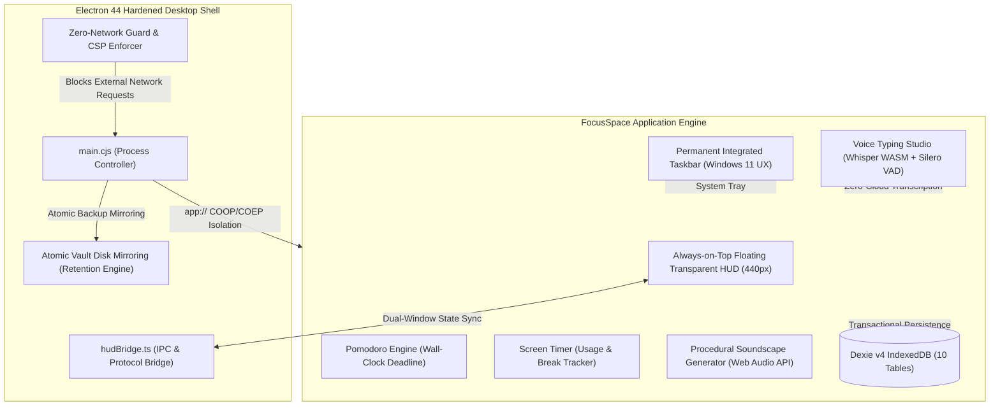

# FocusSpace

<div align="center">

**The Sovereign, Local-First Focus Operating System & Deep Work Studio**

[](package.json)
[](scripts/argus.mjs)
[](src/lib/__tests__/)
[](#-zero-cloud-offline-sovereignty)
[-gold.svg)](#-architectural-design-system--themes)
[](LICENSE)

*A distraction-free, zero-latency desktop environment engineered for flow state, cognitive pacing, and complete data ownership. Built with Electron 44, React 19, TypeScript, Tailwind CSS v4, Dexie v4, and local Whisper WASM.*

</div>

---

## 🌟 Executive Overview

**FocusSpace** is an all-in-one personal workspace and flow-state acceleration suite. It combines task and project orchestration, time-blocking, habit consistency, deep-focus Pomodoro pacing, procedural ambient audio, TipTap knowledge wikis, automated daily journaling, and speech-to-text dictation into a single, cohesive desktop experience.

Unlike conventional productivity tools that lock your thoughts behind cloud subscriptions and surveillance telemetry, FocusSpace runs **100% locally on your machine**:
- **Zero Cloud Servers:** No accounts, no logins, no telemetry, no remote tracking.
- **Strict Network Isolation:** Electron network guards deny all external outbound traffic (`connect-src 'self'`).
- **Offline Machine Learning:** On-device speech recognition via Whisper ASR WASM SIMD and Silero VAD v5.
- **Dual Runtime:** Runs as a hardened Windows desktop application (NSIS installer / portable) and as an offline-capable Progressive Web App (PWA).

---

## 📐 System Architecture



---

## 🚀 Key Features

### 1. 🪟 Permanent Integrated Windows-Style Taskbar
Modeled directly after the Windows 11 taskbar, anchored permanently across the bottom of the workspace with zero padding jitter:
- **FocusSpace Start Hub:** Click the signature logo emblem to instantly return home from any workspace view.
- **Universal Search Box (`Ctrl + K`):** Embedded search bar (`Search anything in FocusSpace...`) with keyboard badge for instant spotlight search across all tasks, pages, habits, and commands.
- **App Launcher with Active Glow Pills:** Pinned application shortcuts with official brand vector SVGs (VS Code, Discord, Spotify, Cursor, Obsidian, Slack, Notion, ChatGPT, Claude, GitHub, Figma, etc.). Running apps or apps attached to active tasks show a vivid bottom accent glow pill.
- **Universal App Addition:** Add native executables (via file path) or web applications with customizable default browser dispatch (Chrome, Edge, Brave, Firefox, Opera, Vivaldi, Arc, Floorp, Zen, or system default).
- **System Tray:**
  - **Screen Time Widget (`⏱️ 1h 24m`):** Live counter showing daily active time with one-click access to the Wellbeing Dashboard.
  - **Focus Timer Mini-Widget:** Remaining Pomodoro time with inline play/pause toggle.
  - **Ambient Sound Toggle:** Quick on/off soundscape button with volume slider.
  - **Voice Typing Button:** Dedicated mic trigger for immediate universal dictation.
  - **System Clock & Calendar Link:** Real-time digital clock and date linking to the Calendar view.
  - **Show Desktop:** Windows-style far-right peek strip.

---

### 2. ⏱️ Screen Timer & Digital Wellbeing Engine
An automated usage analytics and ergonomic pacing system:
- **Automated Active Tracking:** Accurate logging powered by keyboard, mouse, touch, and scroll event listeners.
- **Smart Idle Detection:** Inactivity (>90 seconds) or window minimization/blurring automatically pauses the timer.
- **Workspace Breakdown:** Granular usage distribution across Home, Journal, Calendar, Pages, Analytics, and Settings.
- **Configurable Daily Limits:** Set daily usage thresholds (e.g., 2h, 3h, 4h, 6h, 8h, or Off) with an 80% proactive warning and a 100% daily limit alert.
- **Continuous Session Break Reminders:** Proactive posture and eye-strain alerts (20m, 30m, 45m, 60m continuous active usage) encouraging the 20-20-20 rule.
- **Digital Wellbeing Modal:** Circular progress meter, 7-day usage bar chart, workspace time breakdown, and one-click presets.

---

### 3. 🛸 Always-on-Top Floating Transparent HUD
A frameless, transparent, tactile floating widget (`440px` curved geometry) that floats above full-screen editors, codebases, or video conferences:
- **Zero-Latency Native Drag:** Fluid movement across multi-monitor setups without window frame stutter.
- **Synchronized Theme Styling:** Inherits typography, glassmorphism shadows, and color palettes from the active theme.
- **6 Specialized HUD Artboard Modes:**
  1. **Tactile Focus Dial:** Visual countdown ring with overtime tracking and pause/play controls.
  2. **HUD Todo List:** Check off today's tasks, monitor priorities, and switch active focus tasks without opening the main window.
  3. **In-Session Scratchpad & Subtasks:** Quick Markdown note-taking and subtask checklist synced directly to the active task.
  4. **Ambient Audio Selector:** Switch soundscapes and tweak volume directly from the HUD.
  5. **Quick Add & Voice Dictation:** Capture incoming thoughts on the fly.
  6. **Jump to Dashboard:** One-click bridge returning focus to the primary desktop window.

---

### 4. 🎙️ Universal Offline Voice Studio & Dictation Everywhere
High-accuracy, 100% private speech-to-text dictation running entirely on your local hardware:
- **Local Whisper WASM SIMD:** Powered by Transformers.js and ONNX Runtime Web WASM with multi-threaded CPU and WebGPU acceleration.
- **Silero VAD v5:** Client-side Voice Activity Detection separating active speech from background room noise.
- **Universal Voice Hotkey (`Ctrl + Shift + V` / `Alt + V`):** Focuses any input, textarea, or TipTap document and begins streaming transcription.
- **Ubiquitous Inline Mic Buttons:** Placed natively in the Task Editor, Today Quick Capture, TipTap Knowledge Pages, Daily Journal, Review Canvas, and Command Palette.
- **Disfluency & Punctuation Engine:** Automatically cleans verbal pauses ("um", "uh"), interprets voice commands ("scratch that", "new line", "new paragraph"), and caps utterances at 25 seconds to prevent attention overflow.
- **Zero-Cloud Guarantee:** Completely offline. Audio buffers never leave RAM or touch external APIs.

---

### 5. 🎧 Procedural Ambient Soundscapes
Pure Web Audio API acoustic sound generators created without downloading bulky audio files:
- **Binaural Alpha Waves (10 Hz):** Tuned for sustained mental focus and cognitive flow.
- **Color Noises:** Deep Brown Noise, Balanced Pink Noise, Crisp White Noise.
- **Environmental Soundscapes:** Procedural Rain, Forest Canopy, and Coffee Shop atmosphere.
- **Zero Audio Footprint:** Synthesized in real time with audio buffer nodes, consuming zero disk storage and minimal CPU.

---

### 6. 📅 Core Productivity & Time-Blocking Suite
- **Pomodoro Timer Engine:** Wall-clock deadline architecture (`endsAt`) immune to background tab throttling or OS sleep. Includes configurable focus/break intervals, overtime tracking, and automatic log recording.
- **Task Management (List & Kanban):** Nested subtasks, priority matrices (Low, Medium, High, Urgent), drag-and-drop manual reordering, and anchor-day recurring rules (daily, weekdays, weekly, monthly).
- **FullCalendar Integration:** Month, week, and day grid views with drag-and-drop time-blocking and standard `.ics` export.
- **Habit & Streak Tracker:** Multi-week streak calculation, completion matrices, and custom color accents.
- **Chronological Daily Journal (`Ctrl + J`):** Dedicated reflection space featuring an automated 11:59 PM snapshot engine, morning sleep catch-up, and historical archive.
- **Category Knowledge Pages:** Rich-text wiki built on TipTap (ProseMirror) with live interactive task/habit references, attachments, and hierarchical organization.
- **AI Smart Scheduling:** Local cognitive-load pacing algorithm slotting quick wins first, scheduling deep work during peak hours, and preventing daily overload.
- **Weekly & Monthly Review:** Retrospective reporting with accomplishment showcases, focus duration graphs, habit scores, and one-click Markdown export.

---

## 🎨 Architectural Design System & Themes

FocusSpace ships with **4 high-contrast architectural themes**, each mathematically verified to surpass the **WCAG AAA standard (contrast ratio ≥ 16:1)**:

| Theme | Type | Canvas BG | Text FG | Accent | Measured Contrast |
| :--- | :--- | :--- | :--- | :--- | :---: |
| **Solaris** | Warm Daylight | `#fffdf9` | `#161412` | Warm Terra Amber | **18.09 : 1** (AAA) |
| **Bauhaus** | Crisp Gallery | `#ffffff` | `#0d0f0d` | International Blue | **19.24 : 1** (AAA) |
| **Nocturne** | Deep Midnight | `#0d0c0b` | `#f2ece4` | Warm Ochre | **16.65 : 1** (AAA) |
| **Onyx** | True OLED Black | `#080808` | `#ededed` | Electric Mint | **17.11 : 1** (AAA) |

### Typography
- **Headings & Badges:** *Space Grotesk*
- **Editorial & Quotes:** *Instrument Serif*
- **Technical & Timers:** *JetBrains Mono*
- **Body & Interface:** *Geist Sans*
- *All font files (`.woff2`) are bundled offline within the binary.*

---

## 🛡️ Zero-Cloud Offline Sovereignty

FocusSpace is built from the ground up for strict privacy and data ownership:

```
┌─────────────────────────────────────────────────────────────┐
│                    ZERO NETWORK PERIMETER                   │
├─────────────────────────────────────────────────────────────┤
│  [X] No Analytics        [X] No Telemetry    [X] No Remote Auth │
│  [X] No Cloud Sync       [X] No CDNs         [X] No Trackers    │
│  [✓] 100% Local Storage  [✓] Offline Whisper [✓] Atomic Vault   │
└─────────────────────────────────────────────────────────────┘
```

1. **Electron Session Lockdown:** `session.webRequest.onBeforeRequest` cancels all non-`app://` outbound requests.
2. **Strict Content Security Policy (CSP):** `connect-src 'self'` prevents external HTTP/WebSocket leaks.
3. **Navigation Lock:** Popups and external URL navigations are blocked; external links launch strictly in your preferred external browser with `shell: false` (zero `cmd.exe` injection risk).
4. **Data Vault Mirroring:** IndexedDB database is backed up atomically to the local filesystem on boot and exit with rolling retention and strict regex filename defense (`SAFE_FILENAME_RE`).
5. **Instant JSON Vault Export/Import:** Complete backup and restore round-trip supporting all 10 tables and embedded base64 file attachments.

---

## 🛡️ Argus Quality & Verification Oracle

FocusSpace includes **Argus**, an autonomous 7-tier verification oracle (`scripts/argus.mjs`) that rigorously inspects every architectural boundary before packaging:

```bash
node scripts/argus.mjs --full -v
```

```
========================================================================
  ARGUS // Autonomous FocusSpace Quality & Verification Oracle
  Mode: FULL 7-TIER AUDIT | Strict: YES
========================================================================
  [T1] PASS  TypeScript Static Type & Invariant Integrity
  [T2] PASS  136 Unit, Engine & State Machine Tests (Vitest)
  [T3] PASS  Dexie Database Schema, Attack Matrix & Vault Mirroring
  [T4] PASS  Offline Voice Studio, Silero VAD v5 & Zero-Cloud Guard
  [T5] PASS  Electron Desktop Hardening, CSP, Navigation & High-DPI HUD
  [T6] PASS  Tactile UI, 6 HUD Artboards & WCAG AAA Contrast (>=16:1)
  [T7] PASS  Release Packaging & Option 2 Review Audit
========================================================================
  ARGUS AUDIT SCORECARD: ALL 7/7 TIERS PASSED [HEALTHY]
========================================================================
```

---

## ⌨️ Global Keyboard Shortcuts

| Shortcut | Action |
| :--- | :--- |
| `Ctrl + K` / `⌘K` | Open Universal Search & Command Palette |
| `Ctrl + N` / `⌘N` | Quick Add New Task |
| `Ctrl + Space` | Play / Pause Active Pomodoro Timer |
| `Ctrl + Shift + V` / `Alt + V` | Universal Offline Voice Dictation Everywhere |
| `Ctrl + Alt + H` | Toggle Always-on-Top Floating HUD |
| `Ctrl + 1` | Go to Home (Today Dashboard) |
| `Ctrl + 2` | Go to Calendar View |
| `Ctrl + 3` | Go to Weekly / Monthly Review |
| `Ctrl + 4` | Go to Analytics |
| `Ctrl + 5` | Go to Knowledge Pages |
| `Ctrl + 6` / `Ctrl + J` | Go to Daily Journal |
| `Ctrl + 7` / `Ctrl + ,` | Go to Settings & Data Vault |
| `Ctrl + T` | Cycle Color Theme (`solaris` → `bauhaus` → `nocturne` → `onyx`) |
| `Esc` (Home Screen) | Safe Application Quit Prompt |

---

## 💻 Installation & Development

### Prerequisites
- **Node.js:** `v20.0.0` or higher
- **NPM:** `v10.0.0` or higher
- **Python:** `3.8+` (for packaging scripts)

### Quick Start (Web / PWA)
```bash
# Clone the repository
git clone https://github.com/your-username/focusspace.git
cd focusspace/FocusSpace

# Install dependencies and provision offline voice models
npm install

# Start Vite local development server
npm run dev
```

### Desktop Application (Electron)
```bash
# Launch Electron and Vite in concurrent development mode
npm run electron:dev

# Build production assets and create Windows installer (.exe)
npm run electron:build
```
*The packaged Windows installer will be generated in `dist-electron/FocusSpace Setup 2.4.0.exe`.*

### Testing & Verification
```bash
# Run Vitest test suite (136 tests)
npm test

# Run the full Argus 7-Tier Verification Oracle
npm run argus

# Generate Option 2 lightweight review export (review.txt)
npm run review
```

---

## 📦 Project Structure

```
FocusSpace/
├── electron/
│   ├── main.cjs               # Hardened Electron main process & security guards
│   └── preload.cjs            # Context-isolated IPC bridge
├── public/
│   ├── models/                # Local Whisper ASR & Silero VAD v5 ONNX binaries
│   └── icons/                 # PWA & desktop application icons
├── scripts/
│   ├── argus.mjs              # Argus 7-Tier Autonomous Verification Oracle
│   ├── generate-review.mjs    # Option 2 review export generator (review.txt)
│   └── provision-voice.mjs    # Voice models offline setup script
├── src/
│   ├── components/
│   │   ├── AppDock.tsx        # Permanent integrated Windows-style Taskbar
│   │   ├── ScreenTimeModal.tsx# Digital Wellbeing & Usage Analytics Modal
│   │   ├── FloatingHUD.tsx    # 440px Always-on-top transparent HUD
│   │   ├── BrandIcons.tsx     # Vector SVG brand assets for dock apps
│   │   ├── Pomodoro.tsx       # Flow-state Pomodoro timer
│   │   ├── Journal.tsx        # Daily journal & reflection workspace
│   │   ├── PagesList.tsx      # Category-grouped knowledge wiki
│   │   ├── Calendar.tsx       # FullCalendar time-blocking view
│   │   ├── Analytics.tsx      # Performance metrics and streak visualizations
│   │   └── Settings.tsx       # Theme, soundscape, backup & data vault controls
│   ├── db/
│   │   └── db.ts              # Dexie v4 IndexedDB schema (10 tables)
│   ├── lib/
│   │   ├── screenTimer.ts     # Screen time tracking & break reminder engine
│   │   ├── soundscape.ts      # Procedural Web Audio API sound generator
│   │   ├── timer.ts           # Wall-clock Pomodoro state machine
│   │   ├── backup.ts          # Atomic data vault export/import engine
│   │   └── launcher.ts        # Secure native/web application launcher
│   └── voice/
│       ├── useDictation.ts    # Voice dictation hook
│       ├── capture/vad.ts     # Silero VAD v5 controller
│       ├── engine/            # Web Worker Whisper ASR WASM runner
│       └── ui/DictationHud.tsx# Audio waveform & transcription HUD
└── package.json
```

---

## 📄 License & Sovereignty

FocusSpace is released under the **MIT License**. You own your data, your models, your configurations, and your time. No licenses expire, no servers go down, and no telemetry follows you.
