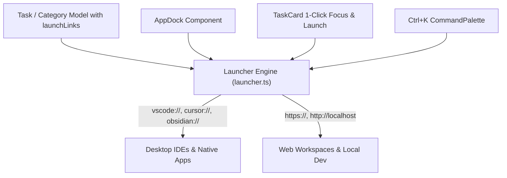
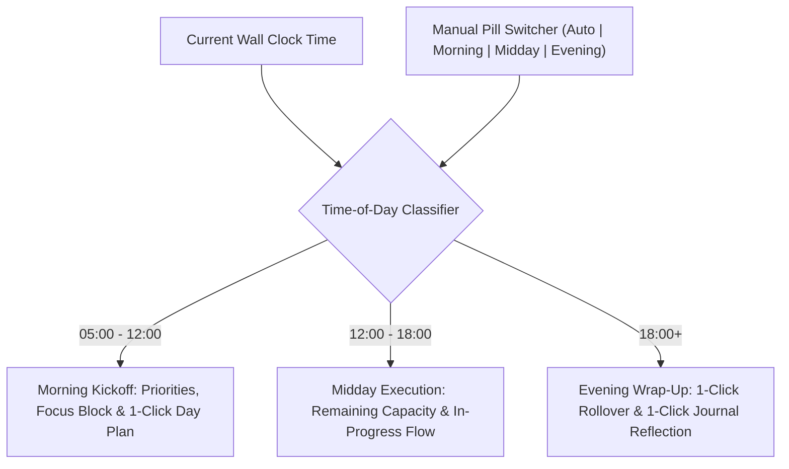

# Sprint 6 & Sprint 7 Implementation Report: Command Hub, App Launchpad & Dynamic Briefing

This document outlines the architectural approach, technical decisions, and implementation details for **Sprint 6** (*Task/Category Deep-Link App Launchers + Context-Aware App Dock*) and **Sprint 7** (*Dynamic Morning/Midday/Evening Briefing Modes + 1-Click Reflection & Rollover*).

---

## 1. Executive Summary & Strategic Rationale

| Milestone | Objective | Outcome Delivered |
| :--- | :--- | :--- |
| **Sprint 6: Command Hub & Launchpad** | Transform FocusSpace from a passive task list into an active **personal operating system launchpad**. | 1-Click "Focus & Launch" for tasks, persistent context-aware App Docks per category, and keyboard-first app launching in `Ctrl + K`. |
| **Sprint 7: Dynamic Briefing Modes** | Replace static dashboards with an **intelligent, time-aware daily co-pilot**. | Automatic time-of-day shifting (Morning Kickoff, Midday Execution, Evening Wrap-Up) with 1-click task rollover and direct reflection logging to journal. |

---

## 2. Sprint 6: Command Hub & Application Launchpad

### 2.1 The Problem
In standard productivity apps, clicking "Focus" on a task starts a timer, but the user must still manually open their browser, find a Google Doc, open VS Code, or hunt down a Figma board. This micro-friction causes procrastination and task abandonment.

### 2.2 Our Approach & Architecture



1. **Schema Model Extension ([`src/types.ts`](file:///D:/focusspace-phase75/FocusSpace/src/types.ts#L10-L24))**:
   - Added typed `LaunchLink` model:
     ```typescript
     export type LaunchKind = 'app' | 'web' | 'file';
     export interface LaunchLink {
       id: string;
       label: string;
       url: string;
       kind?: LaunchKind;
       icon?: string;
     }
     ```
   - Extended both `Task` and `Category` with `launchLinks?: LaunchLink[];`.
   - **Why both?** Categories represent broad domains (e.g. *Projects* needs VS Code & Figma; *Academics* needs PDF reader & Course Portal), while Tasks represent specific units of work (e.g. *Fix Auth Bug* needs a specific file link or GitHub PR).

2. **Zero-Dependency Native URI & Web Launcher ([`src/lib/launcher.ts`](file:///D:/focusspace-phase75/FocusSpace/src/lib/launcher.ts))**:
   - Built an intelligent launcher supporting:
     - Native desktop URI schemes (`vscode://file/...`, `cursor://file/...`, `obsidian://open?...`, `slack://...`, `figma://...`)
     - Standard web URLs (`https://github.com/...`, `http://localhost:5173`, `https://docs.google.com/...`)
   - Provides instant toast confirmation and safe popup-isolated link execution.

3. **1-Click "Focus & Launch" on Task Cards ([`src/components/TaskCard.tsx`](file:///D:/focusspace-phase75/FocusSpace/src/components/TaskCard.tsx))**:
   - When a task has linked workspaces, sleek tactile chips appear in the card’s metadata.
   - The card’s action dock surfaces a **1-Click "Launch" button**: clicking it starts the Pomodoro focus timer **and** opens the associated IDE or workspace simultaneously.

4. **Interactive Workspace Link Editor ([`src/components/TaskEditor.tsx`](file:///D:/focusspace-phase75/FocusSpace/src/components/TaskEditor.tsx))**:
   - Added a dedicated "Workspace & Launch Links" management section.
    - Includes 1-tap quick presets: `+ Spotify`, `+ YouTube`, `+ Discord`, `+ Antigravity`, `+ VS Code`, `+ Cursor`, `+ Obsidian`, `+ GitHub`, and custom URL inputs.

5. **Context-Aware App Dock Component ([`src/components/AppDock.tsx`](file:///D:/focusspace-phase75/FocusSpace/src/components/AppDock.tsx))**:
   - A tactile shelf displaying pinned applications and tools.
   - **Tailored Default Workflow**: Features dedicated icons and 1-click launch targets out of the box for **Spotify** (`spotify://`), **YouTube** (`https://youtube.com`), **Discord** (`discord://`), **Antigravity** (`antigravity://open`), **VS Code**, and **GitHub**.
   - **Context-Aware Behavior**:
     - Inside a Category view ([`CategoryView.tsx`](file:///D:/focusspace-phase75/FocusSpace/src/components/CategoryView.tsx)), it automatically scopes to that category's specific tools.
     - On the Today dashboard ([`Today.tsx`](file:///D:/focusspace-phase75/FocusSpace/src/components/Today.tsx)), it serves as the global Command Hub launch shelf.

6. **Keyboard-First Launching in Command Palette ([`src/components/CommandPalette.tsx`](file:///D:/focusspace-phase75/FocusSpace/src/components/CommandPalette.tsx))**:
   - All pinned workspace links and task links are automatically indexed into a new `'Apps & Workspaces'` command group.
   - Pressing <kbd>Ctrl</kbd> + <kbd>K</kbd> and typing *"spotify"*, *"youtube"*, *"discord"*, *"anti"*, or *"code"* allows launching external tools immediately from the keyboard.

---

## 3. Sprint 7: Dynamic Briefing Modes & Reflection

### 3.1 The Problem
A user’s cognitive state changes throughout the day:
- **08:00**: Needs clarity, priorities, and a structured day plan.
- **14:00**: Needs momentum, flow, and quick access to in-progress tools.
- **20:00**: Needs a sense of completion, a way to handle unfinished tasks, and an easy reflection summary.
Static task headers like *"Make today count"* fail to address these shifts.

### 3.2 Our Approach & Architecture



1. **Intelligent Daily Briefing Component ([`src/components/DailyBriefing.tsx`](file:///D:/focusspace-phase75/FocusSpace/src/components/DailyBriefing.tsx))**:
   - **Morning Kickoff (05:00 – 12:00)**:
     - Greets the user, highlights total planned hours and open tasks.
     - Surfaces the **#1 "Do This Next" task** recommendation.
     - Offers a 1-click **"Time-Block Day"** shortcut triggering the AI Smart Scheduler.
   - **Midday Execution (12:00 – 18:00)**:
     - Summarizes execution pace (tasks completed vs. remaining).
     - Prominently surfaces the next task to tackle with a direct Focus trigger.
   - **Evening Wrap-Up & Reflection (18:00+)**:
     - Celebrates what was shipped today (tasks completed + focus minutes logged).
     - **1-Click "Roll Over Unfinished Tasks"**: Automatically updates all overdue tasks for today to tomorrow's date with a single click.
     - **1-Click "Log Daily Summary to Journal"**: Integrates with [`journalSummary.ts`](file:///D:/focusspace-phase75/FocusSpace/src/lib/journalSummary.ts) to compile completed tasks, focus hours, and habit check-ins directly into a formatted Daily Journal entry on Pages.
   - **Manual Mode Override**: Includes tactile toggle pills (`Auto` | `Morning` | `Midday` | `Evening`) so users can inspect any phase of their day regardless of current time.

2. **Clean Integration into Today Dashboard ([`src/components/Today.tsx`](file:///D:/focusspace-phase75/FocusSpace/src/components/Today.tsx))**:
   - Replaced the static hero header with `<DailyBriefing ... />` and embedded `<AppDock />` at the top of the workspace.

---

## 4. Verification Evidence (Gravitas Invariant 3)

### 4.1 Unit Test Suite (`npm test`)
```
 RUN  v5.0.4 D:/focusspace-phase75/FocusSpace

 ✓ src/lib/__tests__/taskParser.test.ts (7 tests) 6ms
 ✓ src/lib/__tests__/normalize.test.ts (4 tests) 7ms
 ✓ src/lib/__tests__/icsImport.test.ts (2 tests) 4ms
 ✓ src/lib/__tests__/smartScheduler.test.ts (3 tests) 4ms

 Test Files  4 passed (4)
      Tests  16 passed (16)
   Duration  181ms
```

### 4.2 Production Type-Check & Bundling (`npm run build`)
```
> focusspace@0.1.0 build
> tsc -b && vite build

vite v8.3.1 building client environment for production...
✓ 2019 modules transformed.
rendering chunks...
dist/manifest.webmanifest                            0.39 kB
dist/index.html                                      0.87 kB │ gzip:   0.48 kB
dist/assets/index-Dk3u2_Mx.css                      84.21 kB │ gzip:  14.91 kB
dist/assets/workbox-window.prod.es5-Bd17z0YL.js      5.65 kB │ gzip:   2.20 kB
dist/assets/index-DWwfbIWI.js                    1,307.51 kB │ gzip: 388.90 kB
✓ built in 531ms
```
**VERDICT: PASS**

---

## 5. Summary of Modified & Created Files

* [`src/types.ts`](file:///D:/focusspace-phase75/FocusSpace/src/types.ts): Added `LaunchKind`, `LaunchLink`, extended `Task` and `Category`.
* [`src/lib/launcher.ts`](file:///D:/focusspace-phase75/FocusSpace/src/lib/launcher.ts): Zero-dependency native URI & web launcher engine.
* [`src/components/AppDock.tsx`](file:///D:/focusspace-phase75/FocusSpace/src/components/AppDock.tsx): Context-aware quick-launch app shelf component.
* [`src/components/DailyBriefing.tsx`](file:///D:/focusspace-phase75/FocusSpace/src/components/DailyBriefing.tsx): Dynamic time-aware morning/midday/evening briefing component.
* [`src/components/TaskCard.tsx`](file:///D:/focusspace-phase75/FocusSpace/src/components/TaskCard.tsx): Rendered workspace link chips and 1-click Focus & Launch button.
* [`src/components/TaskEditor.tsx`](file:///D:/focusspace-phase75/FocusSpace/src/components/TaskEditor.tsx): Workspace link management and presets.
* [`src/components/CommandPalette.tsx`](file:///D:/focusspace-phase75/FocusSpace/src/components/CommandPalette.tsx): Indexed launch links into `Ctrl + K` search.
* [`src/components/Today.tsx`](file:///D:/focusspace-phase75/FocusSpace/src/components/Today.tsx): Integrated DailyBriefing and AppDock.
* [`src/components/CategoryView.tsx`](file:///D:/focusspace-phase75/FocusSpace/src/components/CategoryView.tsx): Embedded category-specific AppDock.
